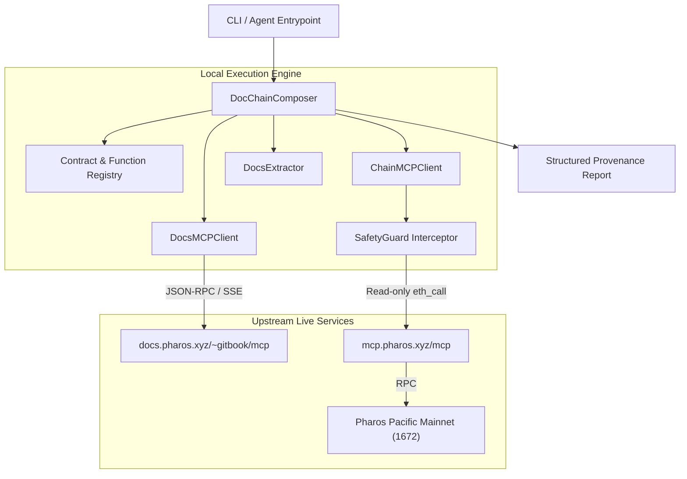

# Technical Architecture: Pharos Doc-Chain Action Agent

## 1. System Overview

The **Pharos Doc-Chain Action Agent** is built to bridge the gap between static smart contract documentation and live EVM state. It communicates with two official Model Context Protocol (MCP) servers:

1. **Official Developer Docs MCP:** `https://docs.pharos.xyz/~gitbook/mcp` (v0.28.0)
2. **Official Hosted Chain MCP:** `https://mcp.pharos.xyz/mcp` (v0.1.0) targeting **Pharos Pacific Mainnet (Chain ID 1672)**.

## 2. Core Modules

### 2.1 `pharos_docs_chain_agent.docs_mcp_client`
- Encapsulates JSON-RPC 2.0 communication over Server-Sent Events (`text/event-stream`).
- Provides `search_documentation(query)` and `get_page(url)`.
- Handles connection timeouts and formats excerpts cleanly into `DocSearchResult`.

### 2.2 `pharos_docs_chain_agent.chain_mcp_client`
- Manages session lifecycle (`mcp-session-id`) with the hosted Chain MCP.
- Guarantees idempotent initialization and prevents invalid session header transmission during handshake.
- Interfaces with `SafetyGuard` to enforce safety checks prior to every remote tool call.
- Provides `get_chain_info()`, `get_code(address)`, and `eth_call(to, data)`.

### 2.3 `pharos_docs_chain_agent.safety`
- Enforces an explicit allowlist of 13 safe read-only tools (`SAFE_READ_ONLY_TOOLS`).
- Hard-blocks `send_raw_transaction` and any state-changing operations (`DISALLOWED_WRITE_TOOLS`).
- Validates that connected chain ID is strictly `1672`.
- Preflights contract bytecode length to ensure contract exists on Pacific Mainnet.

### 2.4 `pharos_docs_chain_agent.contracts`
- Defines canonical contract specifications:
  - `MultiCall3` (`0xcA11bde05977b3631167028862bE2a173976CA11`)
  - `Permit2` (`0x000000000022D473030F116dDEE9F6B43aC78BA3`)
- Encapsulates verified function selectors derived from `keccak256`:
  - `getCurrentBlockTimestamp()` -> `0x0f28c97d`
  - `getBlockNumber()` -> `0x42cbb15c`
  - `DOMAIN_SEPARATOR()` -> `0x3644e515`
- Implements ABI decoders for `uint256`, timestamps, and `bytes32`.

### 2.5 `pharos_docs_chain_agent.composer`
- Orchestrates the full composition loop:
  1. Resolves contract and function specs.
  2. Queries Docs MCP and extracts official documentation text.
  3. Preflights contract bytecode on Pacific Mainnet.
  4. Executes read-only `eth_call` via Chain MCP.
  5. Decodes the live return value.
  6. Contextually synthesizes documentation facts with live on-chain state.
  7. Attaches cryptographic provenance metadata.

---

## 3. Data Flow & Provenance Model

Every output generated by the agent is structured into 4 isolated blocks:
1. **Documentation Facts:** Direct excerpts, parameters, return types, and canonical links.
2. **Live Blockchain Data:** Real on-chain data including chain ID, address, selector, raw hex, and decoded value.
3. **Agent Contextual Interpretation:** Explanation of what the live value signifies according to official documentation.
4. **Cryptographic Provenance:** Tools used, session identifiers, ABI provenance, and UTC timestamp.
